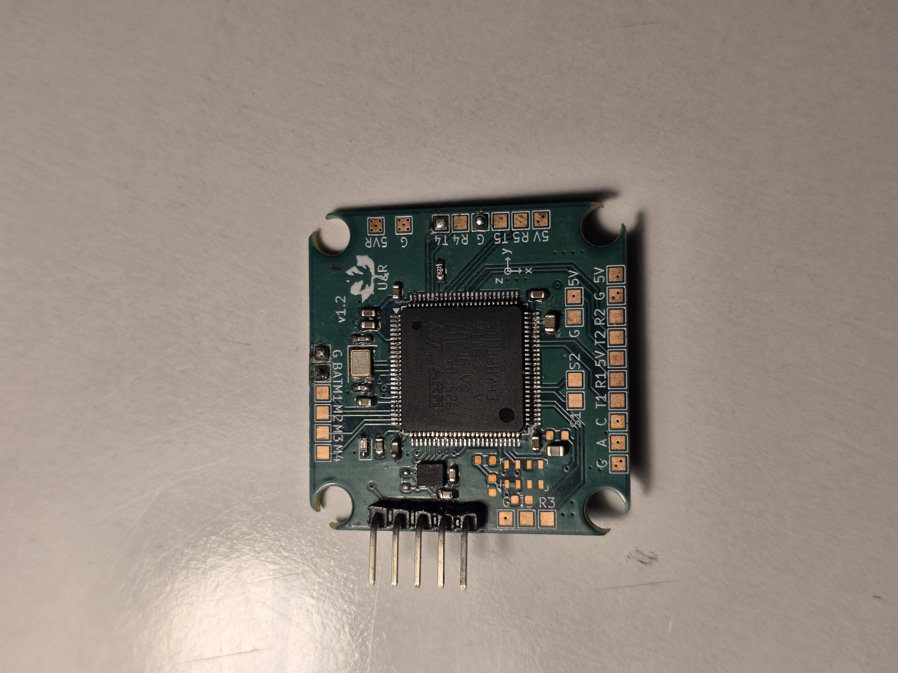
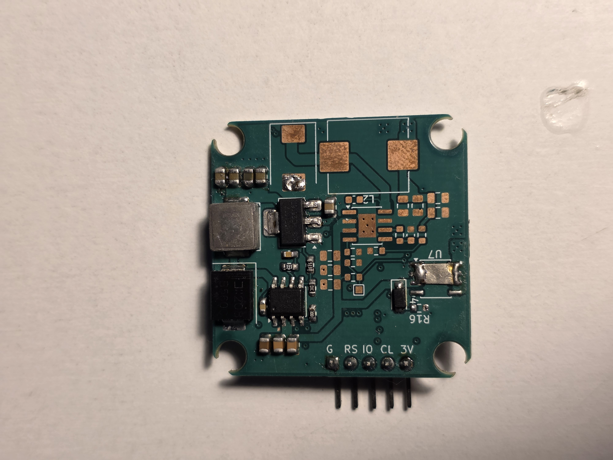
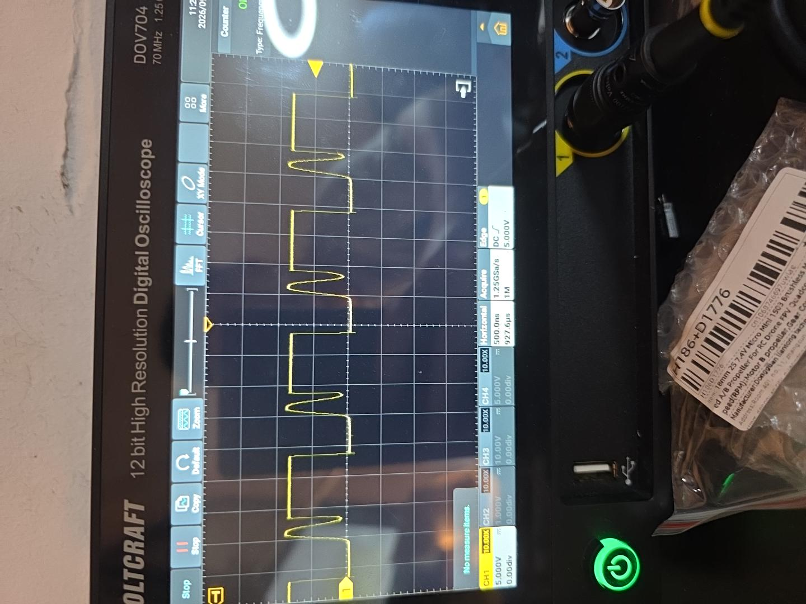
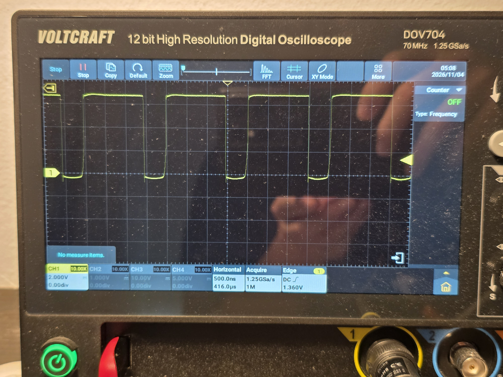

## Drone Flight Controller (Raven)

A simple drone flight controller PCB named "Raven" (because they are smart flying animals), with IMU, barometer, and dual buck converters, designed on KiCad, manufactured and tested.

- 4 Layer PCB
- MCU: STM32H743 (high end chip for compute power in state estimation and control, future proofing)
- IMU: ICM42688 (SPI)
- Baro: MS5611 (I2C)
- Buck converters: Dual async buck based on SCT2650, 5V output for MCU and companion flight computer.
- 4 PWM outputs 
- Auxillary I2C and UARTs for flight computer, flow sensor, GPS 
- ST-Link flashing and debug interface

Debugged: 
- Switching rings in V1.0 due to bad ground return paths 
- Buck IC smoked due to conductive residual solder flux

Assembled PCB and some scope tests: 

V1.0 has some ringing on the SW node of the buck: 

V2.0 has cleaner waveforms: 
